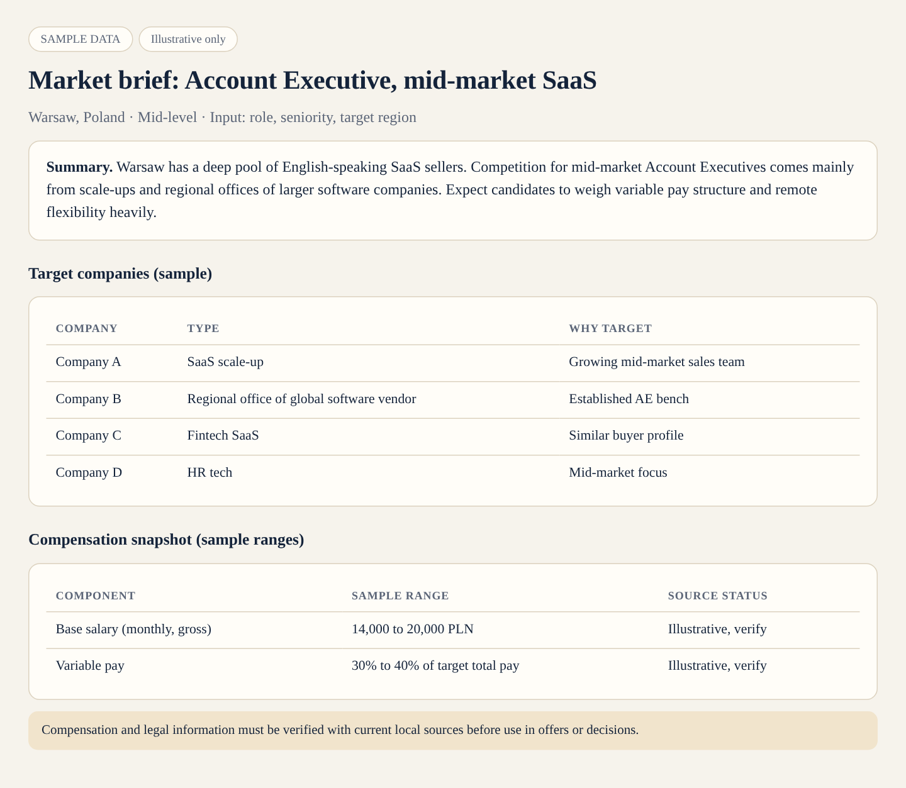
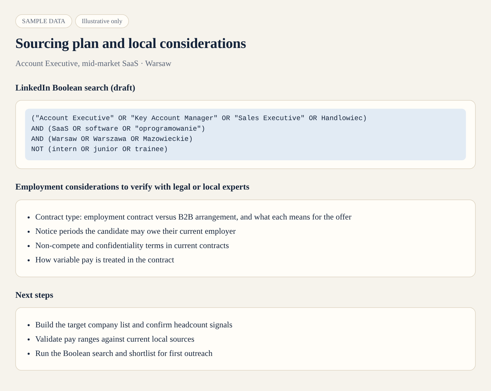

# Poland Sales Hiring: Market Intelligence Workflow

An AI-assisted workflow built with Claude to support recruiting for sales roles in Poland.

> **Note:** this repo contains the workflow design only. All data shown is sample data. No employer, candidate, or compensation data is included.

## The problem

Recruiting sales talent in a market outside the US means researching a lot before the first outreach: who the competitors are, what roles cost, how the local market works, and what employment rules apply. Doing this by hand for every search is slow and inconsistent.

## What it does

- Builds competitor and target company lists
- Summarizes market and compensation ranges from public sources
- Drafts LinkedIn Boolean search strings
- Flags local employment considerations to verify with legal or local experts
- Produces a one-page market brief per role

## How it works

1. **Input:** role, seniority, target region.
2. The agent researches and structures the findings using a fixed template.
3. **Output:** a market brief and sourcing plan a recruiter can act on the same day.

## Example

**Input:** Account Executive, mid-market SaaS, Warsaw

**Output:** a market brief (above) and a sourcing plan (below). Both use sample data.

## Files

- **images/**: preview screenshots of the sample output
- **README.md**: this file

## Limits

Compensation and legal information should always be verified with current local sources before use in offers or decisions.

## Built with

Claude by Anthropic. No coding required.

## About me

I'm Michele Burns, a senior technical recruiter with 15+ years of experience across engineering, design, product, and sales hiring, including time at GitHub, and the founder of Burns Talent Solutions.
